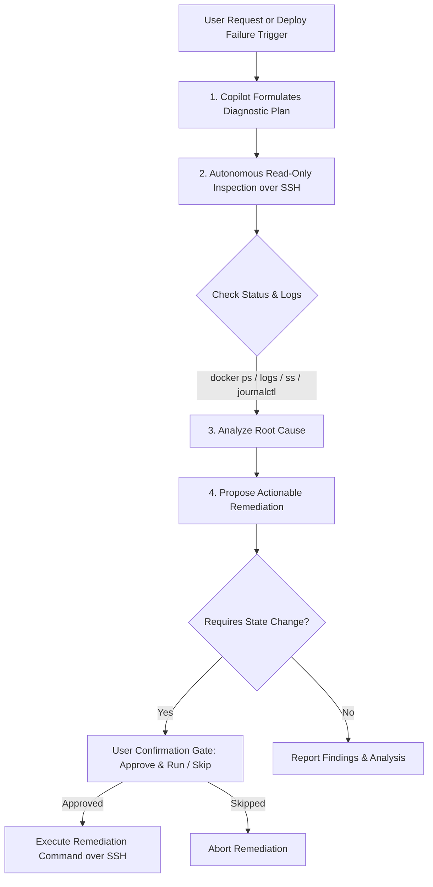

# AI SRE Copilot

The 7Server **AI SRE Copilot** is an agentic troubleshooting assistant designed specifically for Linux server operations and application deployment lifecycles.

Rather than giving generic boilerplate answers, the Copilot **inspects the actual state of your server over SSH before answering**, providing precise root-cause analysis and executable remediations.

---

## How Copilot Agent Mode Works

When you ask a question like *"Why is my API returning 502 errors?"* or trigger a failure recovery action, the Copilot performs an autonomous diagnostic loop:

---

## Deployment Integration

7Server embeds the AI SRE Copilot directly into the application deployment pipeline:

### 1. Pre-Flight Architecture Review (`✨ AI Pre-Flight Review`)

Located directly in the Git Deployment modal:
- Before triggering builds or starting processes, click **✨ AI Pre-Flight Review**.
- 7Server dispatches your deployment blueprint—including detected frameworks, build scripts, port assignments, and monorepo package configurations—to Copilot.
- Copilot validates your setup, warns of potential port clashes or missing environment variables, and recommends best-practice startup configurations.

### 2. Autonomous Deployment Failure Recovery (`✨ Fix with AI Copilot`)

When an application deployment or monorepo stack service fails (for example, exit code 1 during container startup or health check failure):

1. **Context-Aware Event Bridge**: 7Server displays an alert banner in the deployment terminal and dispatches a `7server-copilot-ask` event to the Copilot Drawer.
2. **Automated Payload Transfer**: The event automatically injects:
   - Target server and application name
   - Failed deployment pipeline stage
   - Repository URL, branch, and configured internal port
   - The trailing 35 lines of terminal stderr and container logs
3. **Autonomous Investigation**: Copilot immediately inspects the server:
   - Queries `docker ps --filter "name=<app>"` to verify container health.
   - Inspects `docker logs --tail 50 <app>` to capture runtime stack traces.
   - Runs `ss -tulpn` to detect listening ports and binding conflicts.
4. **Interactive Fix Proposal**: Copilot outlines the failure cause and renders a formatted command card with an **Approve & Run** button, allowing you to apply the fix with a single click.

---

## Safety Rails & Injection Hardening

1. **Strict Read-Only Allowlist**: Commands like `systemctl status`, `docker ps`, `docker stats`, `docker logs`, `ss`, `netstat`, `df`, `free`, and `journalctl` run automatically without interrupting you.
2. **Untrusted Data Fencing**: Remote server outputs (terminal logs, command stderr) are strictly quarantined from AI prompt instructions using sentinel delimiters to prevent prompt-injection attacks from untrusted log entries.
3. **Explicit Approval Gates**: Any command that modifies system state—such as stopping/recreating containers, modifying Nginx configurations, altering firewall rules, or editing `.env` files—**requires an explicit user confirmation click**.
4. **Step Budget Limit**: Copilot operates within a hard limit of 8 autonomous diagnostic steps per query to guarantee predictable execution and prevent runaway agent loops.
