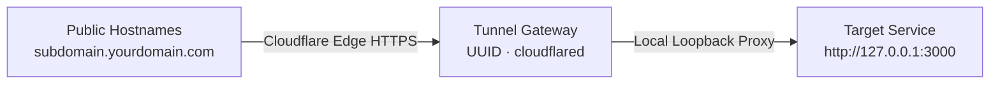

# Cloudflare Tunnels & Zero-Trust Ingress

7Server provides built-in integration with **Cloudflare Tunnels** (`cloudflared`), enabling you to expose internal web applications and services securely to the internet through the Cloudflare edge without opening any public firewall ports or requiring a public IPv4 address.


---

## Why Use Cloudflare Tunnels?

- **0 Open Inbound Ports**: The `cloudflared` daemon creates an outbound-only connection to Cloudflare edge nodes. No open port 80 or 443 is required on your firewall or security group.
- **NAT & Private IP Traversal**: Easily expose applications hosted in homelabs, local networks, or private cloud environments (such as Tailscale or internal VPC subnets).
- **Automated DDoS Protection & Edge SSL**: Benefit from Cloudflare's global DDoS mitigation and automated SSL termination at the edge.

---

## 1-Click Setup: Zero Trust Token Connector

Setting up a tunnel on any target server takes less than 30 seconds from the **Nginx & Domains › Cloudflare Tunnels** tab:

1. Click **Setup Cloudflare Tunnel**.
2. Select the **⚡ Zero Trust Token (1-Click)** tab.
3. Paste either your 64+ character tunnel token or the full installation command from the Cloudflare Zero Trust dashboard:
   ```bash
   curl -L --output cloudflared.deb https://github.com/cloudflare/cloudflared/releases/latest/download/cloudflared-linux-amd64.deb && sudo dpkg -i cloudflared.deb && sudo cloudflared service install <TOKEN>
   ```
4. 7Server automatically extracts the token, verifies `cloudflared` presence (installing the official binary package if missing), installs the system service, and verifies the connection status.

For teams managing existing certificate credentials, 7Server also supports the **💻 CLI Login (`cert.pem`)** workflow with tunnel UUID mapping.

---

## Visual Ingress Topology Map

The **Visual Map** tab renders an interactive 3-column architecture flow for your server's ingress routing:



- **Public Hostnames**: Displays all configured public domains and subdomains with external links.
- **Tunnel Gateway**: Shows the tunnel UUID, daemon status (Healthy/Active), config path (`/etc/cloudflared/config.yml`), and host address.
- **Target Services**: Shows local reverse proxy destinations (e.g. `http://localhost:80` for Nginx or `http://localhost:3000` for application runtimes).

---

## Smart Pointing from the Apps Tab

When viewing your deployed applications in the **Apps** tab, 7Server automatically checks server network topology:

- **Public IP VPS**: Displays **+ Point Domain** (Sky Blue), creating an Nginx virtual host with Let's Encrypt SSL and real-time DNS pre-flight verification.
- **Private / Tailscale Server**: Displays **+ Point Tunnel** (Amber), opening the tunnel route configuration modal pre-populated with the application's internal port.

Clicking **+ Point Tunnel** allows you to:
1. Select an existing deployed application from a dropdown list to automatically fill its port.
2. Enter the public hostname (e.g. `api.yourdomain.com`).
3. Toggle **Auto-create Cloudflare DNS route** to run `cloudflared tunnel route dns <tunnel> <hostname>` automatically on the server.

---

## DNS Pre-Flight Validation

Before attempting to route public traffic, 7Server provides a real-time DNS pre-flight check. It queries DNS records to ensure the hostname resolves properly before reloading configurations, preventing certificate issuance failures and broken ingress routes.

