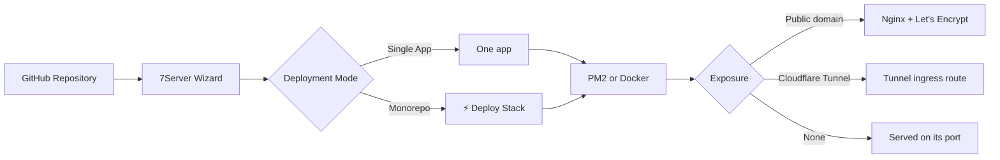

# Web Apps, Git Deployment & Monorepo Stacks

7Server deploys applications straight from GitHub to your servers over SSH. Pick a repository, check the detected settings, and 7Server clones, builds, starts and (optionally) puts Nginx and a Let's Encrypt certificate in front of the app. Nothing is installed on the server except the software the app itself needs.

---

## Overview

Deploys are started from the **Apps** tab of a server (**Deploy New App**) and run through a 3-step wizard: **Select Repository → Configure & Build → Live Deployment**. The deploy runs as a background task, so you can leave the page and come back to the live log.

---

## Connecting GitHub

- **Personal Access Token (PAT)**: paste a token; the wizard links to GitHub with the needed scopes preselected.
- **GitHub OAuth**: available once you save a GitHub OAuth client ID and secret in 7Server.
- **Repository browser**: lists the repositories your account can access (personal and organization, public and private).
- **Branch selection**: pick any branch of the repository.

GitHub is the only Git provider today. Private repositories are cloned with the token sent as an HTTP header, so it is not written into `.git/config`.

---

## Framework Detection

When you select a repository (or a sub-folder of it), 7Server reads its manifests through the GitHub API and fills in suggested commands and a default port:

| Detected | Based on | Runs as | Default port |
| :--- | :--- | :--- | :--- |
| **Docker** | `Dockerfile` or a compose file (`docker-compose.yml`, `compose.yaml`, …) | Docker | port from compose / `EXPOSE`, else 3000 |
| **Next.js** | `next` dependency or `next.config.*` | PM2 | 3000 |
| **Nuxt** | `nuxt` dependency or `nuxt.config.*` | PM2 (`node .output/server/index.mjs`) | 3000 |
| **SvelteKit / Remix / Astro** | their packages in `package.json` | PM2 | 3000 (Astro 4321) |
| **Vite / SPA** | `vite`, `react-scripts` or `vue` without a server framework | Static files (no start command) | 3000 |
| **Node.js API** | Express, Fastify, NestJS, Hono or Koa | PM2 | 3001 |
| **Node.js** | any other `package.json` | PM2 | 3000 |
| **Laravel / PHP** | `composer.json` (Laravel via `laravel/framework`) | Nginx + PHP-FPM | 8000 |
| **Python** | `requirements.txt`, `Pipfile`, `pyproject.toml`, `main.py`, `app.py` | PM2 | 8000 |
| **Go** | `go.mod` | PM2 (`./app`) | 8080 |
| **Static** | none of the above | Static files | 3000 |

For Node.js projects the install command follows the lockfile (`pnpm install`, `yarn install`, `bun install` or `npm ci`). The wizard also reads the Node version the repo asks for (`engines.node`, `.nvmrc` or `.node-version`).

A compose file that only runs supporting services (a database or cache, no build) next to a Node.js or PHP app is treated as a **sidecar**: the app is deployed normally and `docker compose up -d` starts those services first.

You can switch to a different framework preset and edit every command and the port before deploying.

---

## Environment Variables (.env)

1. **`.env.example` parsing**: keys from `.env.example`, `.env.sample` or `.env.template` in the selected folder are loaded into the form with their example values.
2. **Paste .env**: paste raw `KEY=value` text to fill the form in one go.
3. **Written with 0600 permissions**: on deploy, the variables are written to `.env` in the app folder, readable only by its owner. Keys from the repo's `.env.example` that you did not fill in keep their example value; your values win.
4. **Port and host defaults**: `PORT` and `HOST=0.0.0.0` (plus the Nuxt/Nitro equivalents) are added unless you set them yourself.

---

## Ports

- When the wizard opens, 7Server reads the server's listening TCP ports and suggests the first free port at or above the framework default (80 and 443 are never suggested). If the port you typed is taken, a **Busy → Use :N** button offers the next free one.
- The deploy refuses to start an app on a port that another app already holds, instead of reporting someone else's app as healthy.

---

## Exposure: Domain, Tunnel or None

Under **Configure & Build** you choose how the app is reached:

- **Public domain**: Nginx serves the domain and Certbot requests a certificate. While you type the domain, a [DNS pre-flight check](/workloads/cloudflare-tunnel#dns-pre-flight-check) shows whether it already points at the server.
- **Cloudflare Tunnel**: the hostname is added to the server's `cloudflared` ingress config and routed in Cloudflare DNS. See [Cloudflare Tunnel](/workloads/cloudflare-tunnel). This mode is preselected when `cloudflared` is running and the server's address is private or a Tailscale IP.
- **None**: no domain. The app is served directly on its port (it is started with `HOST=0.0.0.0`), and static sites get an Nginx server block on that port.

---

## What a Deploy Does

The live view shows these pipeline stages with the streamed log:

0. **Install Server Software** (only when something is missing): git, Node.js, PM2, Docker/Compose, Nginx, Certbot, PHP/Composer, Python or Go, depending on the app. Node.js is upgraded when it is older than the major version the repo asks for. On a non-root user, 7Server asks for the sudo password once (and can save it).
1. **Clone Git Repository**: shallow clone into `/var/www/<app>`. A redeploy fetches the branch and resets to it. An existing folder that is not a git checkout is never overwritten.
2. **Inject Environment (.env)**: writes `.env` as described above.
3. **Install Dependencies**
4. **Compile & Build Artifact**
5. **Process Manager & Port**: PM2 (process named after the app, saved with `pm2 save`) or Docker (container `7server-<app>` with `--restart unless-stopped`, or the repo's compose stack).
6. **Reverse Proxy & Health Check**: writes the Nginx site, requests the certificate, then checks the app answers on its port.

Details that keep small servers and odd repos working:

- **Low memory**: on a server with less than ~3 GB RAM and no swap, a 2 GB swap file is created before building. If the kernel kills the build for running out of memory, the log says so.
- **No hanging builds**: install and build run without stdin and with `CI=1` and framework telemetry disabled, and print a heartbeat with free RAM every 30 seconds.
- **Docker port mapping**: for compose stacks, the app's published port is set to the port you chose, and other host ports that are already taken (for example a second Postgres on 5432) are moved to a free port on `127.0.0.1`.
- **Honest health check**: 7Server polls `http://127.0.0.1:<port>/` for about 30 seconds. Without a domain it also checks that a process on this server really listens on the port. If nothing answers, the log lists the listening ports and the app's recent logs, and the deploy is marked **failed**, not live.
- **Wrong port in the app**: if a PM2 app listens on a different port than configured, 7Server bridges the configured port to it with Nginx.
- A deploy can run for up to 30 minutes.

---

## Nginx & SSL

When a domain is set, or the app is static/PHP without a start command:

- The site is written to `/etc/nginx/sites-available/7server-<app>` and symlinked into `sites-enabled`.
- Apps with a process (PM2/Docker) are proxied with `proxy_pass http://127.0.0.1:<port>`, including WebSocket upgrade headers (`Upgrade`, `Connection "upgrade"`) and `Host` / `X-Real-IP` / `X-Forwarded-*` headers.
- Static and PHP apps are served from the first build folder found (`dist`, `build`, `out`, `.output/public`, `public`), with PHP-FPM when the root contains `index.php`.
- The config is checked with `nginx -t` before Nginx is reloaded.
- With a public domain, Certbot runs `certbot --nginx -d <domain> --redirect`, which issues the certificate and redirects HTTP to HTTPS. If the request fails (usually DNS not pointing at the server yet), the deploy logs a warning and the site stays on HTTP.

The **SSL & Certificates** tab lists certificates and flags the ones that expire within 30 days.

---

## Monorepo Stacks (`⚡ Deploy Stack`)

When the repository has deployable projects in sub-folders (any folder with a `package.json`, `composer.json`, `Dockerfile`, compose file, `requirements.txt`, `pyproject.toml`, `go.mod`, …), the wizard shows **Monorepo Detected** with two modes:

- **Single App**: pick one package folder and deploy it on its own.
- **⚡ Deploy Stack**: select several packages and configure each one separately: app name, framework preset, install/build/start commands, port (each package gets its own free port) and `.env`.

**Deploy Stack** deploys the selected packages **one after another**, each through the same pipeline as a single app. If one fails, the remaining ones are not started. The live view has a tab per service (`backend (:8001)`, `frontend (:3000)`, …) with its own stages and log, and when all are done it shows a **Visit** link for each service.

---

## AI Assistance

### ✨ AI Pre-Flight Review

Before deploying, **✨ AI Pre-Flight Review** opens the [AI Copilot](/ai/copilot) with your deploy settings: app name, repository, branch, detected framework, root folder and port (or, for a stack, each package with its name, port, framework and number of env vars). It asks Copilot to look for port collisions, compose or env settings that need changing, and dependencies between services before you deploy.

### ✨ Fix with AI Copilot

When a deploy fails, the live view shows a **Fix with AI Copilot** button. It opens Copilot with:

- the app name, repository, branch and port
- the stage that failed
- the last 35 lines of the deploy log

Copilot then investigates the server with the deploy playbook loaded (where 7Server puts apps, PM2 and Docker names, the Nginx site path). Read-only commands run on their own in Agent mode; anything that changes the server waits for you to click **Run**.

---

## Managing Deployed Apps

The **Apps** tab lists every folder in `/var/www` with its detected framework, Nginx domain or port, git branch and last change. Per app you can open its files, edit `.env`, open an SSH terminal in the folder, and run actions from the **Actions** menu:

- git status / `git pull`, Laravel log and `artisan` helpers, PM2 restart, `npm run build` (+ restart), Docker restart, folder size
- **Point Domain (Nginx)**: create an Nginx site for an existing app and, optionally, a Let's Encrypt certificate
- **Point to Cloudflare Tunnel**: add a tunnel route for the app (when `cloudflared` is installed)
- **Delete app**

**Delete app** removes everything a deploy set up for that folder:

1. PM2 processes running from the folder
2. the Docker container and any compose stack in the folder
3. Nginx sites that serve only this folder (backed up to `/root/7server-removed/` first). Configs shared with another app are kept.
4. Certbot certificates for those sites' domains, and matching Cloudflare Tunnel ingress routes
5. the folder itself (its `.env` is backed up to the same place first)
