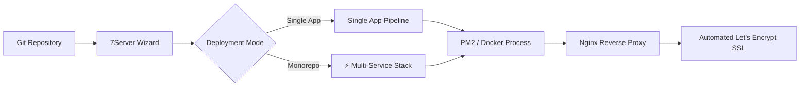

# Web Apps, Git Deployment & Monorepo Stacks

7Server provides a comprehensive, production-grade application deployment workflow. Connect your Git repositories, deploy individual web applications or multi-service monorepos, configure Nginx reverse proxies, and provision automated Let's Encrypt SSL certificates—all completely agentless over SSH.

---

## Overview

Deploying applications traditionally requires repetitive terminal operations: cloning repos, installing runtimes, configuring environment variables, setting up process supervisors (PM2/Docker), tuning Nginx vhosts, and obtaining SSL certificates.

7Server automates this entire lifecycle into a unified 3-step wizard with real-time streaming pipeline feedback and built-in AI SRE diagnostics.



---

## Connecting Git Providers

7Server integrates directly with Git providers:

- **GitHub Integration**: Connect via Personal Access Token (PAT) with `repo` scope or GitHub OAuth.
- **Repository Browser**: Automatically lists your personal and organization repositories (both public and private).
- **Branch Selection**: Select any branch or tag; pipelines automatically track changes from the selected branch.
- **Monorepo Detection**: Subfolders and workspace directories (`apps/*`, `packages/*`, `/backend`, `/frontend`) are automatically discovered.

---

## Intelligent Framework Detection

When you select a repository or package folder, 7Server scans repository manifests to detect the underlying framework and runtime:

| Framework / Runtime | Detected Manifests | Default Build Command | Default Start / Process |
| :--- | :--- | :--- | :--- |
| **Next.js** | `next` in `package.json` | `npm run build` | `npm start` (PM2) |
| **Nuxt** | `nuxt` in `package.json` | `npm run build` | `node .output/server/index.mjs` (PM2) |
| **Node.js / Express** | `package.json` | `npm run build` *(if present)* | `npm start` (PM2) |
| **Vite / SPA** | `vite` in `package.json` | `npm run build` | Static Nginx root / PM2 preview |
| **Laravel / PHP** | `composer.json`, `artisan` | `composer install --no-dev` | `php artisan serve` / PHP-FPM |
| **Docker Container** | `Dockerfile` | `docker build -t <app> .` | `docker run -d` |
| **Docker Compose** | `docker-compose.yml`, `compose.yaml` | `docker compose build` | `docker compose up -d` |
| **Python** | `requirements.txt`, `Pipfile` | `pip install -r requirements.txt` | `uvicorn` / `gunicorn` |
| **Go** | `go.mod` | `go build -o app` | `./app` |

Presets automatically populate the recommended package install commands, build commands, start scripts, and default internal listening ports. All fields remain fully customizable.

---

## Automated Environment (.env) Configuration

To eliminate tedious manual environment configuration:

1. **Automatic `.env.example` Parsing**: 7Server reads any `.env.example` or `.env.sample` present in the repository root or package subdirectory.
2. **Key-Value Extraction**: Variable keys are automatically extracted into the UI form, ready for secret values.
3. **Secure SSH Injection**: Environment variables are written directly to `/var/www/<app-name>/.env` with strict `0600` Linux permissions, ensuring non-root processes cannot read sensitive credentials.
4. **Bulk Raw Import**: Paste `.env` text directly or upload existing `.env` files with automatic duplicate deduplication.

---

## Conflict-Free Port Assignment

Every deployed application requires a dedicated internal listening port. 7Server eliminates port collision errors:

- Scans the target server's active TCP sockets (`ss -tulpn`) before provisioning.
- If the default framework port (e.g., `3000` or `8000`) is already bound by another service, 7Server automatically assigns the next available non-privileged port (e.g., `3001`, `3002`, `8001`).
- The internal port is passed directly to the application environment (`PORT=<port>`) and registered with the reverse proxy.

---

## Monorepo Multi-Deploy Stack (`⚡ Deploy Stack`)

Modern projects frequently live in monorepos containing multiple interdependent applications—such as a Laravel or Go backend paired with a React or Next.js frontend, worker processes, and microservices.

7Server features a dedicated **Monorepo Stack Deployer**:

### 1. Dual Deployment Modes

When a monorepo structure is detected, you can choose:
- **Single App Mode**: Deploy only a specific subfolder as an independent service.
- **⚡ Deploy Stack Mode**: Configure and deploy multiple sub-packages in one coordinated workflow.

### 2. Multi-Package Checklist & Blueprint

In Stack Mode, 7Server displays discovered subdirectories (e.g. `/backend`, `/frontend`, `/docs`):
- Check the packages you want to include in the stack.
- Click any selected package tab to configure its individual parameters independently:
  - Custom Application Name
  - Framework Preset (e.g., Laravel for backend, Next.js for frontend)
  - Process Manager (PM2 or Docker Container)
  - Build & Start Commands
  - Dedicated conflict-free internal listening port
  - Package-specific `.env` configuration

### 3. Sequential Orchestrated Execution

Clicking **Deploy Stack** executes sequential deployment for each service:
- Services are built and started in order, preventing resource spikes on your VPS.
- **Multi-Tab Live Pipeline**: The deployment terminal provides tabs for each service (`backend (:8003)`, `frontend (:3000)`). Switch between tabs in real-time to watch stdout/stderr streams.
- **Real-Time Stage Indicators**: Track the 6 deployment pipeline stages per service:
  1. Clone / Fetch Git Repository
  2. Inject Environment Variables (`.env`)
  3. Install Runtime Dependencies
  4. Compile & Build Artifacts
  5. Process Manager Startup & Port Binding
  6. Reverse Proxy & Health Probe Verification
- **Aggregated Stack Summary**: When all services finish, an overview card displays direct links to each deployed app along with their internal and public URLs.

---

## AI-Assisted Deployment & Diagnostic Recovery

7Server bridges its autonomous AI SRE Copilot directly into the deployment workflow:

### ✨ AI Pre-Flight Architecture Review

Before triggering a deployment, click **✨ AI Pre-Flight Review** in the configuration modal:
- 7Server sends repository blueprints, monorepo package configuration, port assignments, and runtime commands to Copilot.
- Copilot analyzes potential issues (such as missing build arguments, port conflicts, database dependency order, or incompatible Node/Python versions) and advises on optimizations before you run the build.

### ✨ Fix with AI Copilot (Deployment Failure Recovery)

If a deployment fails at any stage:

```
[ Deployment Failed (Exit Code 1) ]
----------------------------------------------------------------------
🚨 Deploy Failed? Let AI Copilot Diagnose & Fix (Autonomous SRE)
7Server AI Copilot can analyze failure logs, inspect listening sockets,
check container status, and automatically patch the configuration.
[ ✨ Fix with AI Copilot ]
----------------------------------------------------------------------
```

1. **One-Click Diagnostic Context**: Clicking **Fix with AI Copilot** automatically opens the SRE Copilot drawer and injects:
   - Target server and application name
   - Failed deployment stage (e.g., `Process Manager & Port` or `Compile & Build Artifact`)
   - Repository URL, branch, and target internal port
   - The trailing 35 lines of terminal stderr and container logs
2. **Autonomous SSH Inspection**: Copilot runs read-only commands over SSH:
   - Verifies whether Docker containers are trapped in crash-restart loops (`docker ps -a`)
   - Inspects application logs directly (`docker logs --tail 50 <container>` or PM2 logs)
   - Checks listening sockets (`ss -tulpn` or `lsof -i :<port>`)
3. **Actionable Remediation**: Copilot explains the root cause (e.g., container missing mounted source files, unmapped internal port, or database connection refused) and presents an executable, one-click patch for your approval.

---

## Reverse Proxy Topology & SSL Hardening

Once your processes are running, 7Server connects them to the web:

### Automated Nginx Reverse Proxy

- Creates dedicated virtual host configurations in `/etc/nginx/sites-available/<app-name>` and symlinks them to `/etc/nginx/sites-enabled/`.
- Configures upstream proxying to the application's internal loopback port (`proxy_pass http://127.0.0.1:<port>`).
- Includes WebSocket upgrade headers (`Upgrade $http_upgrade`, `Connection "upgrade"`) by default.
- Sets client body upload limits (`client_max_body_size 64M`) and optimized proxy buffering.

### Automated Let's Encrypt SSL

- **One-Click Certificate Provisioning**: Issues free TLS certificates using Certbot over ACME HTTP-01 challenges.
- **Auto-Renewal Verification**: Monitors expiration dates and displays warnings when certificates are within 30 days of expiring.
- **SSL Hardening**: Automatically configures modern TLS 1.2/1.3 ciphers, HSTS headers, and HTTP-to-HTTPS redirects.
